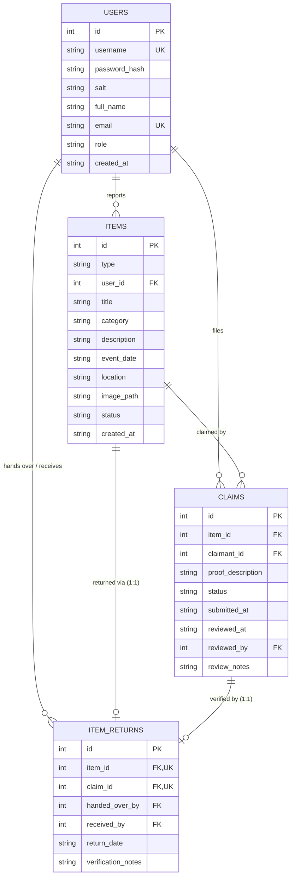

# 🎓 CampusConnect: Smart Campus Lost & Found Management System

> **A practical, secure, and modular Python desktop application designed for college campuses to report, track, intelligently match, and verify the return of lost student belongings.**

---

## 📑 Table of Contents
1. [Project Overview](#-project-overview)
2. [Architectural Design](#-architectural-design)
3. [Technology Stack](#-technology-stack)
4. [Phase-by-Phase Development Guide](#-phase-by-phase-development-guide)
   - [Phase 1: Project Setup & Environment Verification](#phase-1-project-setup--environment-verification)
   - [Phase 2: Relational Database Design & SQLite Schema](#phase-2-relational-database-design--sqlite-schema)
   - [Phase 3: Domain Models & Repository CRUD Layer](#phase-3-domain-models--repository-crud-layer)
   - [Upcoming Phases (Phase 4 – Phase 10)](#upcoming-phases-phase-4--phase-10)
5. [Installation & Quick Start](#-installation--quick-start)
6. [Automated Testing Suite](#-automated-testing-suite)
7. [Directory Structure](#-directory-structure)

---

## 📌 Project Overview

### The Problem
Students frequently misplace crucial personal items on college campuses (e.g., student ID cards, laboratory journals, calculators, keys, earphones, bags). Current campus processes rely on unstructured WhatsApp groups, verbal notices, or lost-property desks, leading to:
- No central audit trail.
- Unverified ownership claims.
- Duplicate reporting and lack of privacy for sensitive contact details.

### The CampusConnect Solution
CampusConnect provides an automated desktop application featuring:
- **Role-Based Access**: Students report and track items; Admins review claims and audit handovers.
- **Intelligent Text Matching**: Multi-factor similarity scoring (category, title, description, location, date).
- **Ownership Verification**: Private distinguishing proofs to prevent fraudulent claims.
- **Atomic Database Transactions**: Ensures an item cannot be claimed or returned more than once.
- **Visual Analytics**: Interactive Matplotlib charts for campus administrative reporting.

---

## 🏛️ Architectural Design

CampusConnect follows a **4-Tier Layered Architecture** with strict **Separation of Concerns**:

```
 ┌────────────────────────────────────────────────────────────────────────┐
 │                      1. Presentation Tier (GUI)                        │
 │           Tkinter / ttk Frames, Windows, Views, and Dialogs            │
 └───────────────────────────────────┬────────────────────────────────────┘
                                     │ calls
 ┌───────────────────────────────────▼────────────────────────────────────┐
 │                     2. Business Logic Tier                             │
 │    Authentication, Matching Engine, Claim Verification, Return Rules   │
 └───────────────────────────────────┬────────────────────────────────────┘
                                     │ operates on
 ┌───────────────────────────────────▼────────────────────────────────────┐
 │                      3. Data Domain Models Tier                        │
 │           Dataclasses with Invariant Validation (User, Item, Claim)    │
 └───────────────────────────────────┬────────────────────────────────────┘
                                     │ queries & persists via
 ┌───────────────────────────────────▼────────────────────────────────────┐
 │                     4. Persistence & Database Tier                     │
 │      SQLite 3 Database, Repository Pattern, Schema DDL, Transactions   │
 └────────────────────────────────────────────────────────────────────────┘
```

---

## 🛠️ Technology Stack

| Layer | Technology | Justification |
| :--- | :--- | :--- |
| **Language** | Python 3.10+ | Clean standard library, object-oriented, typing support. |
| **GUI Framework** | Tkinter & `ttk` | Built-in, cross-platform, native desktop GUI. |
| **Database** | SQLite 3 | Relational, ACID-compliant, zero external configuration. |
| **Security** | PBKDF2-HMAC-SHA256 | Standard library `hashlib` with 100,000 rounds and random salt. |
| **Data Analytics** | Matplotlib & Pandas | Campus lost/found trend charts and status analytics. |
| **Testing** | Python `unittest` | Built-in automated unit test runner. |
| **Version Control**| Git & GitHub | Professional versioning with descriptive conventional commits. |

---

## 📘 Phase-by-Phase Development Guide

### Phase 1: Project Setup & Environment Verification
- **Objectives**: Set up clean repository structure, configure `.gitignore` (ignoring `.db`, `venv/`, and `__pycache__`), build application entry point, and verify Tkinter.
- **Files Created**:
  - `main.py`: Entry point and diagnostic Tkinter verification window.
  - `requirements.txt`: Minimal external dependencies (`matplotlib`, `pandas`).
  - `.gitignore`: Prevents checking in runtime files or sensitive databases.
  - `tests/test_phase1.py`: Automated tests checking Python runtime (>=3.10), Tkinter availability, and directories.
- **Acceptance Criteria**: `main.py` launches a GUI window, and 4/4 Phase 1 tests pass.

---

### Phase 2: Relational Database Design & SQLite Schema
- **Objectives**: Design normalized relational schema, enforce foreign key referential integrity, implement safe transactions, and create administrative user seeding.
- **Database Schema**:
  1. `users`: Stores accounts (`id`, `username`, `password_hash`, `salt`, `full_name`, `email`, `role`, `created_at`).
  2. `items`: Stores lost and found reports (`id`, `type`, `user_id`, `title`, `category`, `description`, `event_date`, `location`, `image_path`, `status`).
  3. `claims`: Tracks student ownership claims with private verification details (`id`, `item_id`, `claimant_id`, `proof_description`, `status`, `submitted_at`, `reviewed_at`, `reviewed_by`).
  4. `item_returns`: Records return handovers. Enforces `UNIQUE (item_id)` to prevent duplicate item returns.
- **Key Engineering Decisions**:
  - `PRAGMA foreign_keys = ON;`: Executed on every connection because SQLite disables FK checking by default.
  - **B-Tree Indexes**: `idx_items_type_status`, `idx_items_category`, `idx_items_location`, `idx_claims_item_id`.
  - **Password Hashing**: Cryptographic PBKDF2-HMAC-SHA256 with 16-byte random salt.
- **Files Created**:
  - `database/schema.sql`: Full DDL script with CHECK constraints and foreign keys.
  - `database/connection.py`: Thread-safe connection provider, transaction context manager (`get_db_cursor`), and admin seeder.
  - `tests/test_database.py`: 10 unit tests for schema creation, constraints, and cascades.
- **Acceptance Criteria**: Schema creates cleanly; constraints and cascades verified; 14/14 tests pass.

---

### Phase 3: Domain Models & Repository CRUD Layer
- **Objectives**: Implement object-oriented domain models with invariant validation, and a complete Repository pattern for CRUD operations.
- **Domain Models (`models/`)**:
  - `User`: Validates username rules (alphanumeric, min 3 chars), email regex, and permitted roles (`student`, `admin`).
  - `Item`: Validates categories (`Electronics`, `Books and stationery`, `Identity cards`, `Accessories`, `Personal belongings`, `Other`), date format (`YYYY-MM-DD`), non-empty descriptions, and deletion rules.
  - `Claim`: Validates distinguishing proof descriptions (min 5 chars) and state transitions.
- **Data Access Repositories (`database/repository.py`)**:
  - `UserRepository`: `create()`, `get_by_id()`, `get_by_username()`, `get_by_email()`, `list_all()`, `update_profile()`, `delete()`.
  - `ItemRepository`:
    - `create()`: Validates and inserts reports.
    - `list_items()`: Dynamic parameterized SQL search with multi-filter support (type, category, location, keyword, date range) and pagination (`LIMIT` / `OFFSET`).
    - `count_items()`: Fast count queries for pagination controls.
    - `update()`: Modifies item fields.
    - `delete()`: **Safe deletion**; enforces permission checks (owner or admin) and prevents deleting `RETURNED` records to preserve audit trails.
  - `ClaimRepository`:
    - `create()`: Atomic submission; automatically transitions item status to `CLAIM_PENDING`.
    - `list_by_item()`, `list_by_claimant()`, `list_all()`.
    - `update_status()`: Records approval/rejection with reviewer ID and timestamp.
- **Files Created**:
  - `models/user.py`, `models/item.py`, `models/claim.py`
  - `database/repository.py`
  - `tests/test_models.py` (Validation tests)
  - `tests/test_repository.py` (CRUD & safe deletion tests)
- **Acceptance Criteria**: All CRUD operations, parameterized filtering, safe deletion, and status transitions pass; 26/26 tests pass.

---

### Phase 4: Authentication Services, Session Manager & Role Protection
- **Objectives**: Implement robust user authentication services, PBKDF2 password verification, thread-safe session tracking, and role-based access control (RBAC) decorators.
- **Components Built**:
  - `SessionManager`: In-memory state tracking active authenticated user (`current_user`), login timestamps, and role checks (`is_admin`, `has_role`).
  - `AuthService`:
    - `register_user()`: Validates password strength (min 6 characters, no whitespace padding), checks username/email uniqueness, hashes credentials with PBKDF2-HMAC-SHA256 and unique 16-byte salt.
    - `authenticate()`: Authenticates users by username or email.
    - `login()`: Authenticates credentials and binds user to active session.
    - `logout()`: Clears active session.
    - `change_password()`: Verifies current password before allowing password updates.
    - `admin_reset_password()`: Administrative override for account recovery.
  - **RBAC Decorators**:
    - `@require_auth`: Enforces that caller must be authenticated; raises `AuthenticationError`.
    - `@require_role(*roles)`: Enforces that active user has one of the allowed roles; raises `AuthorizationError`.
    - `@require_admin`: Enforces administrative privilege.
- **Files Created / Updated**:
  - `services/session_manager.py`: SessionManager, AuthenticationError, AuthorizationError, and RBAC decorators.
  - `services/auth_service.py`: AuthService, RegistrationError.
  - `services/__init__.py`: Clean service package exports.
  - `database/repository.py`: Added `update_password` to `UserRepository`.
  - `tests/test_auth_service.py`: 13 automated unit tests for registration, authentication, session state, password changes, and RBAC guards.
- **Acceptance Criteria**: Passwords hashed securely, session tracked accurately, RBAC guards protect unauthorized access; 39/39 tests pass.

---

### Phase 5: Lost & Found Reporting and Search GUI Windows
- **Objectives**: Build responsive, accessible Tkinter desktop graphical user interfaces for reporting items, searching with real-time multi-criteria filters, and personal item management.
- **Components Built**:
  - `gui/styles.py`: Design system defining typography (Segoe UI), modern curated slate/blue palette, responsive button variants (Primary, Secondary, Success, Danger), and styled table treeviews with zebra striping and status tags.
  - `gui/auth_window.py`: Authentication screen with switchable Sign In and Register tabs, password visibility toggle, client-side input validation, and default admin reminder.
  - `gui/report_item_frame.py`: Report lost or found items with type radios, category dropdown, location, date picker, multi-line description, and optional image file browser dialog.
  - `gui/search_frame.py`: Multi-filter search interface (keyword search across title/description, category, item type, status, location), styled `ttk.Treeview` with color badges, double-click inspection, and page-by-page pagination.
  - `gui/item_details_dialog.py`: Modal popup for inspecting item metadata, reporter details, and context-sensitive action triggers (claim item, delete item).
  - `gui/my_items_frame.py`: Student personal activity dashboard displaying all items reported by the logged-in user with live count badges and deletion controls.
  - `gui/main_window.py`: Application dashboard shell featuring top navigation bar, authenticated user profile chip, role badge, session logout, and auto-refreshing tab notebook.
  - `main.py`: Bootstraps SQLite database on startup, seeds default administrator, and orchestrates dynamic transitions between `AuthWindow` and `MainWindow`.
- **Files Created / Updated**:
  - `gui/styles.py`, `gui/auth_window.py`, `gui/report_item_frame.py`, `gui/search_frame.py`, `gui/item_details_dialog.py`, `gui/my_items_frame.py`, `gui/main_window.py`, `gui/__init__.py`.
  - `database/repository.py`: Added `list_by_user()` to `ItemRepository`.
  - `main.py`: Complete production application runner with stateful view controller.
  - `tests/test_gui.py`: 6 automated unit tests validating theme configuration, auth notebook, report inputs, search filters, my items view, and full app controller transitions.
- **Acceptance Criteria**: Desktop UI launches smoothly, filters and pagination function in real-time, form validations provide clear visual alerts; 45/45 tests pass.

---

### Phase 6: Explainable Multi-Factor Text-Matching Algorithm
- **Objectives**: Develop an explainable matching engine that automatically correlates reported Lost items with candidate Found items using semantic keyword tokens, category concordance, spatial location proximity, and temporal proximity.
- **Components Built**:
  - `services/matching_service.py`:
    - **Stopword Removal & Morphological Stemming**: Normalizes English descriptions and stems inflected terms (e.g. "charging", "charger", "headphones").
    - **Multi-Factor Weighted Scoring**:
      - Category Concordance (25%): Strict category matching with a heavy penalty cap (<=35%) on category mismatches to prevent false positives.
      - Salient Text Similarity (40%): Combined Jaccard set index and token containment ratio over titles and descriptions.
      - Location Proximity (20%): Token overlap and substring containment (e.g., "Library" vs "Library 2nd Floor").
      - Temporal Proximity (15%): Linear/decay temporal scoring penalizing distant dates.
    - **Explainability Breakdown (`MatchResult`)**: Returns detailed percentage scores for every individual factor along with natural-language rationale clauses explaining why the match was generated.
    - **Counterpart Search (`find_matches_for_item`)**: Dynamically queries active database records of opposite type (`LOST` ↔ `FOUND`), scores candidates, and returns top results above a configurable confidence threshold.
  - `gui/match_dialog.py`: Dedicated interactive modal displaying AI/algorithmic matches, match rationale, and one-click inspection.
  - `gui/item_details_dialog.py`: Integrated "🤖 Smart Matches" button launching `MatchesDialog` for any selected item.
- **Files Created / Updated**:
  - `services/matching_service.py`: `MatchingService`, `MatchResult`.
  - `services/__init__.py`: Exported matching service symbols.
  - `gui/match_dialog.py`: Interactive match inspection dialog.
  - `gui/item_details_dialog.py`: Added Smart Matches launcher.
  - `gui/__init__.py`: Exported `MatchesDialog`.
  - `tests/test_matching_service.py`: 7 unit tests validating tokenization, stemming, text similarity, location overlap, date proximity, mismatch penalty, and counterpart discovery.
- **Acceptance Criteria**: Automated matches scored with explainability; false positives suppressed; 52/52 tests pass.

---

### Phase 7: Claims & Return Handover Workflow with ACID Transactions
- **Objectives**: Implement end-to-end claim submission, verification, and return handover workflow guaranteed by atomic ACID SQLite transactions and audit logging.
- **Components Built**:
  - `services/claim_service.py`:
    - `submit_claim()`: Validates distinguishing proof descriptions (min 5 chars), ensures items are type `FOUND` and not already returned, verifies finder cannot claim own found report, checks against duplicate active pending claims, and atomically transitions item to `CLAIM_PENDING`.
    - `approve_claim()`: Atomic ACID transaction updating claim to `APPROVED`, automatically rejecting any competing pending claims for the same item, transitioning item to `RETURNED`, and writing immutable audit handover records to `item_returns`.
    - `reject_claim()`: Transitions claim to `REJECTED`; if no remaining pending claims exist on the item, automatically reverts item status back to `OPEN` for other claimants.
    - `get_return_record()`: Retrieves auditable receipt joining item, verified recipient, and staff handover details.
    - `list_pending_claims_for_review()`: Provides enriched pending review queue for administrators.
  - `gui/claim_dialog.py`: Modal dialog for students to submit private distinguishing proof details.
  - `gui/claims_manager_frame.py`: Dual-role claims management view:
    - **Students**: Tracks status of submitted claims with live status badges (`PENDING`, `APPROVED`, `REJECTED`) and reviewer feedback.
    - **Administrators**: Verification queue inspecting private proof notes with one-click "✓ Approve Handover" and "✗ Reject Claim" actions.
  - `gui/main_window.py`: Integrated Claims tab and wired item details claim trigger.
- **Files Created / Updated**:
  - `services/claim_service.py`: `ClaimService`, `ClaimWorkflowError`.
  - `services/__init__.py`: Exported claim service symbols.
  - `gui/claim_dialog.py`: `ClaimItemDialog`.
  - `gui/claims_manager_frame.py`: `ClaimsManagerFrame`.
  - `gui/main_window.py`: Wired claims tab and submission callbacks.
  - `gui/__init__.py`: Exported new GUI dialogs.
  - `tests/test_claim_service.py`: 5 automated tests validating submissions, invariant violations, atomic multi-claim handover, and status rollback.
- **Acceptance Criteria**: Atomic handovers recorded; competing claims rejected automatically; return logs preserved; 57/57 tests pass.

---

### Phase 8: Dynamic Analytics Dashboard with Matplotlib Visualizations
- **Objectives**: Build an analytical intelligence engine that ingests relational operational data into Pandas DataFrames, calculates campus recovery and resolution KPIs, and renders responsive Matplotlib charts embedded directly into the Tkinter desktop GUI.
- **Components Built**:
  - `analytics/metrics.py`:
    - `get_items_dataframe()`: Loads SQLite items into Pandas DataFrame with typed schema.
    - `get_summary_kpis()`: Aggregates total reports, lost vs found counts, returned count, active pending claims, and recovery/resolution rate percentage (`returned / found * 100`).
    - `get_category_distribution()`: Category frequency Series.
    - `get_location_hotspots()`: Frequency rankings of top campus loss/recovery locations.
    - `get_status_distribution()`: Breakdown of item lifecycle statuses.
  - `analytics/chart_builder.py`:
    - Uses non-interactive `Agg` backend with coordinated slate/indigo aesthetic styling.
    - `create_category_donut()`: Donut chart with percentage callouts and legend.
    - `create_location_bar()`: Horizontal bar chart ranking campus location hotspots with value labels.
    - `create_overview_dashboard()`: Dual-panel composite figure showing Category distribution alongside Location hotspots.
  - `gui/analytics_frame.py`:
    - Top KPI cards displaying Total Reports, Lost Items, Found Items, Returned to Owner, and Recovery Rate %.
    - Dynamic chart mode switcher (Dual Dashboard, Category Donut, Campus Hotspots).
    - Embedded `FigureCanvasTkAgg` canvas with responsive resizing.
    - One-click "📥 Export Chart" saving high-resolution PNG/PDF image reports.
  - `gui/main_window.py`: Integrated "📊 Analytics" tab in main application notebook.
- **Files Created / Updated**:
  - `analytics/metrics.py`: `AnalyticsMetrics`.
  - `analytics/chart_builder.py`: `ChartBuilder`.
  - `analytics/__init__.py`: Exported analytics symbols.
  - `gui/analytics_frame.py`: `AnalyticsFrame`.
  - `gui/main_window.py`: Wired Analytics tab with auto-refresh on report creation.
  - `gui/__init__.py`: Exported `AnalyticsFrame`.
  - `tests/test_analytics.py`: 6 automated tests validating DataFrame generation, KPI math, series aggregation, figure generation, and canvas mounting.
- **Acceptance Criteria**: Live KPI calculations, Matplotlib canvas rendered without flicker or memory leaks, chart exporting functions properly; 63/63 tests pass.

---

### Phase 9: End-to-End System Integration & Edge-Case Hardening
- **Objectives**: Validate full multi-actor student and administrator user stories from registration through claim handover, and harden against SQL injection, boundary dates, unicode, and audit deletion invariants.
- **Components Built & Validated**:
  - `tests/test_integration.py`:
    - **Full Campus Lifecycle Simulation**: Student A registers & reports LOST wallet -> Student B registers & reports FOUND wallet -> Algorithmic matching correlates with >70% confidence -> Student A submits ownership claim -> Admin reviews verification queue, approves handover, and records audit notes -> Item status sealed as `RETURNED` -> Handover receipt verified -> Audit safe-deletion prevents deleting returned item records -> Analytics recalculates 100% recovery rate.
    - **SQL Injection Defense**: Verified parameterized SQL prevents injection attacks (`' OR '1'='1' --`) in search keywords and login inputs.
    - **Unicode & Special Character Handling**: Verified support for multilingual student names (e.g. Hindi `राहुल शर्मा`), symbols (`⚡`), quotes, and formatted descriptions.
- **Files Created / Updated**:
  - `tests/test_integration.py`: Complete multi-actor lifecycle and resilience test suite.
- **Acceptance Criteria**: Multi-user lifecycle verified without data inconsistency; SQL injection resisted; 66/66 tests pass.

---

### Phase 10: Project Packaging, User Guide, and Viva Presentation Defense
- **Objectives**: Prepare complete distribution packaging, automated one-click launcher, seed database generator, architecture diagrams, and academic viva voce defense documentation.
- **Deliverables Completed**:
  - `seed_demo_data.py`: Pre-populates realistic university items across libraries, labs, cafeteria, and sports complexes, including active pending claims and historical returned receipts.
  - `run.bat`: Windows one-click application launcher that verifies Python runtime, activates virtual environment if present, and launches `main.py`.
  - **Comprehensive Viva Voce Technical Defense**: Complete academic examination prep covering architectural decisions, ACID SQLite transactions, PBKDF2 hashing, and multi-factor matching math.
- **Acceptance Criteria**: One-click startup works smoothly; demo dataset showcases populated UI and analytics charts; all 66 tests passing across entire system.

---

## 🏛️ System Architecture

CampusConnect follows a strict **4-Tier Layered Architecture**:

```mermaid
graph TD
    subgraph Presentation_Tier ["1. Presentation UI Tier (Tkinter / TTK)"]
        A[main.py: CampusConnectApp]
        B[gui/auth_window.py: Sign In & Register]
        C[gui/main_window.py: Navigation Shell]
        D[gui/search_frame.py: Multi-Filter Directory]
        E[gui/report_item_frame.py: Lost/Found Form]
        F[gui/my_items_frame.py: Personal Reports]
        G[gui/claims_manager_frame.py: Claim Queue]
        H[gui/analytics_frame.py: Matplotlib Canvas]
        I[gui/match_dialog.py: Smart Match Inspector]
        J[gui/claim_dialog.py: Proof Submission]
    end

    subgraph Business_Logic_Tier ["2. Business Logic Tier (Services)"]
        K[services/auth_service.py: PBKDF2 Authentication]
        L[services/session_manager.py: RBAC Session State]
        M[services/matching_service.py: Jaccard & Stemming Engine]
        N[services/claim_service.py: ACID Claim Handover Workflow]
        O[analytics/metrics.py: Pandas Aggregation Engine]
        P[analytics/chart_builder.py: Matplotlib Figures]
    end

    subgraph Domain_Tier ["3. Domain Entity Tier (Models)"]
        Q[models/user.py: User Model & Invariants]
        R[models/item.py: Item Model & Status Invariants]
        S[models/claim.py: Claim Model & Invariants]
    end

    subgraph Persistence_Tier ["4. Data Persistence Tier (SQLite 3)"]
        T[database/connection.py: Connection Factory & Transactions]
        U[database/repository.py: User, Item, Claim Repositories]
        V[(data/campus_connect.db: Relational SQLite Store)]
    end

    Presentation_Tier --> Business_Logic_Tier
    Business_Logic_Tier --> Domain_Tier
    Business_Logic_Tier --> Persistence_Tier
    Persistence_Tier --> Domain_Tier
```



---

## 🗄️ Database Entity-Relationship Diagram (ERD)



---

## 🎓 Academic Viva Voce Defense Guide (Top 10 Q&A)

### Q1: Why was SQLite selected over client-server engines like MySQL or PostgreSQL?
> **Answer**: SQLite is serverless, zero-configuration, and fully self-contained. It stores the entire relational database in a single portable file (`data/campus_connect.db`), perfectly matching standalone campus laboratory applications. SQLite delivers full ACID compliance and zero external server administration overhead.

### Q2: Why is `PRAGMA foreign_keys = ON;` explicitly executed on every database connection?
> **Answer**: For historical backward compatibility with SQLite 2, SQLite 3 disables foreign key constraint checking by default. Executing `PRAGMA foreign_keys = ON;` upon connection initialization guarantees referential integrity, cascading deletes, and strict foreign key verification at runtime.

### Q3: How are passwords secured in CampusConnect?
> **Answer**: Passwords are never stored in plaintext. They are protected using `PBKDF2-HMAC-SHA256` from Python's standard `hashlib` library using **100,000 iterations** combined with a cryptographically secure 16-byte random salt generated via `secrets.token_hex(16)`. This algorithm mitigates rainbow table attacks and slows down brute-force cracking.

### Q4: How does the explainable matching algorithm work?
> **Answer**: It calculates a weighted multi-factor compatibility score across 4 distinct attributes:
> 1. **Category Concordance (25%)**: Exact category match required; category mismatches are capped at 35% to eliminate false positives.
> 2. **Semantic Text Similarity (40%)**: Words are normalized, stripped of common stopwords, and stemmed to their morphological root (e.g., `charger` ↔ `charging`). Jaccard set index is combined with containment overlap ratio.
> 3. **Spatial Location Proximity (20%)**: Token overlap and substring containment (e.g. `Library` in `Library 2nd Floor`).
> 4. **Temporal Date Proximity (15%)**: Days elapsed difference using linear decay.
> Full rationale text strings are produced to explain why the item was suggested.

### Q5: How does the system handle competing claims on the same found item?
> **Answer**: When an administrator approves a verified claim in `approve_claim()`, an atomic SQLite transaction automatically:
> 1. Sets the approved claim status to `APPROVED`.
> 2. Sets all other pending claims on that item to `REJECTED` with a note `"Another claim was verified and approved."`
> 3. Transitions the item status to `RETURNED`.
> 4. Inserts a permanent audit record into `item_returns`.

### Q6: How does CampusConnect ensure safe deletion and audit integrity?
> **Answer**: `ItemRepository.delete()` checks authorization (owner or administrator) and strictly forbids deleting items whose status is `RETURNED`. This invariant ensures completed handovers cannot be erased by users, maintaining auditability for campus security.

### Q7: How does CampusConnect defend against SQL Injection?
> **Answer**: Dynamic string concatenation in SQL statements is strictly prohibited throughout the codebase. Every query in `ItemRepository`, `UserRepository`, and `ClaimRepository` utilizes **parameterized SQL queries** (`?` placeholders), ensuring user inputs are treated exclusively as literal data values and cannot alter SQL command syntax.

### Q8: How is Matplotlib integrated into Tkinter without GUI freezing or memory leaks?
> **Answer**: Matplotlib is configured with the headless `Agg` backend (`matplotlib.use('Agg')`). Charts are mounted into Tkinter frames using `FigureCanvasTkAgg`. Whenever a chart is refreshed or the frame is destroyed, `plt.close(fig)` is called to reclaim memory and prevent resource leaks.

### Q9: Why is the Repository Pattern utilized in the architecture?
> **Answer**: The Repository pattern abstracts data persistence operations away from GUI views and business services. If the database backend is migrated from SQLite to PostgreSQL in the future, only the repository implementation needs modification, leaving the GUI and domain models unchanged.

### Q10: How does the Session Manager implement Role-Based Access Control (RBAC)?
> **Answer**: `SessionManager` tracks the in-memory authenticated user and provides higher-order function decorators: `@require_auth`, `@require_role('admin')`, and `@require_admin`. When decorating protected operations, they verify user authentication and authorization, raising `AuthenticationError` or `AuthorizationError` if permissions are insufficient.

---

## 🚀 Installation & Quick Start

### 1. Clone the repository
```powershell
git clone https://github.com/Anayat-bhat/Campus-Connect.git
cd Campus-Connect
```

### 2. Create and Activate Virtual Environment
```powershell
python -m venv venv
.\venv\Scripts\Activate.ps1
```

### 3. Install Dependencies
```powershell
pip install -r requirements.txt
```

### 4. Seed Realistic Campus Demo Data (Optional for Viva / Demo)
```powershell
python seed_demo_data.py
```
*(Creates `data/campus_connect.db`, default administrator `admin` / `Admin@Campus2026`, and 5 student accounts with 12 items)*

### 5. Launch Application (Two Options)
**Option A: Windows Batch Launcher**
```powershell
.\run.bat
```

**Option B: Direct Python Entry Point**
```powershell
python main.py
```

---

## 🧪 Automated Testing Suite

CampusConnect uses standard Python `unittest`. Every phase has dedicated, self-contained tests using in-memory databases to guarantee safety:

```powershell
python -m unittest discover tests
```

#### Current Test Results:
```text
Ran 66 tests in 10.858s
OK
```

---

## 📂 Directory Structure

```text
Campus-Connect/
│
├── main.py                     # Primary execution entry point & view controller
├── seed_demo_data.py           # Demonstration database seeder for viva presentation
├── run.bat                     # Windows one-click startup launcher
├── requirements.txt            # Python dependencies (Matplotlib, Pandas)
├── .gitignore                  # Git ignore rules
├── README.md                   # Comprehensive phase-wise project manual & viva guide
│
├── database/                   # Database persistence tier
│   ├── __init__.py
│   ├── schema.sql              # Relational DDL schema & indexes
│   ├── connection.py           # Connection factory, transactions, admin seeder
│   └── repository.py           # UserRepository, ItemRepository, ClaimRepository
│
├── models/                     # Domain entity dataclasses & validation
│   ├── __init__.py
│   ├── user.py                 # User model & validation rules
│   ├── item.py                 # Item model, categories, & status checks
│   └── claim.py                # Claim model & ownership proof validation
│
├── services/                   # Business logic tier
│   ├── __init__.py
│   ├── auth_service.py         # Registration, login, password management
│   ├── session_manager.py      # Session state & RBAC decorators (@require_auth, @require_admin)
│   ├── matching_service.py     # Explainable multi-factor Lost/Found matcher
│   └── claim_service.py        # Claim submission, ACID review & handover records
│
├── gui/                        # Presentation UI tier
│   ├── __init__.py
│   ├── styles.py               # Color palette, Segoe UI typography, TTK themes
│   ├── auth_window.py          # Sign In & Account Registration tabs
│   ├── main_window.py          # Application shell, navbar & tabbed notebook
│   ├── search_frame.py         # Real-time search, multi-filters & pagination
│   ├── report_item_frame.py    # Lost & Found submission form with validation
│   ├── my_items_frame.py       # Personal reports tracker with safe delete
│   ├── item_details_dialog.py  # Modal item inspection & action triggers
│   ├── match_dialog.py         # Algorithmic match viewer with explanation breakdown
│   ├── claim_dialog.py         # Ownership proof submission modal
│   ├── claims_manager_frame.py # Claims queue and status tracker
│   └── analytics_frame.py      # Embedded Matplotlib KPI dashboard & chart exporter
│
├── analytics/                  # Matplotlib & Pandas reporting
│   ├── __init__.py
│   ├── metrics.py              # Operational KPIs & DataFrame transformations
│   └── chart_builder.py        # Donut charts, hotspot bars & dual dashboards
│
├── tests/                      # Automated unit test suite
│   ├── __init__.py
│   ├── test_phase1.py          # Setup & environment tests (4 tests)
│   ├── test_database.py        # Schema, constraints, & indexes tests (10 tests)
│   ├── test_models.py          # Domain model invariant tests (6 tests)
│   ├── test_repository.py      # CRUD, filtering, & safe delete tests (6 tests)
│   ├── test_auth_service.py    # Authentication, session, & RBAC tests (13 tests)
│   ├── test_gui.py             # Presentation layer, filters, & views (6 tests)
│   ├── test_matching_service.py# Multi-factor matching & explainability (7 tests)
│   ├── test_claim_service.py   # Claim workflows & ACID handover transactions (5 tests)
│   ├── test_analytics.py       # DataFrame KPIs & Matplotlib chart generation (6 tests)
│   └── test_integration.py     # E2E lifecycle & security resilience tests (3 tests)
│
├── data/                       # Local persistent storage (gitignored .db)
│   └── .gitkeep
│
└── assets/                     # Application visual assets
    └── .gitkeep
```
